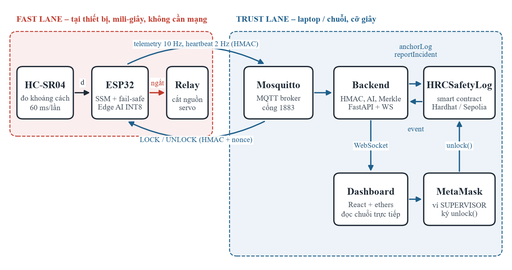
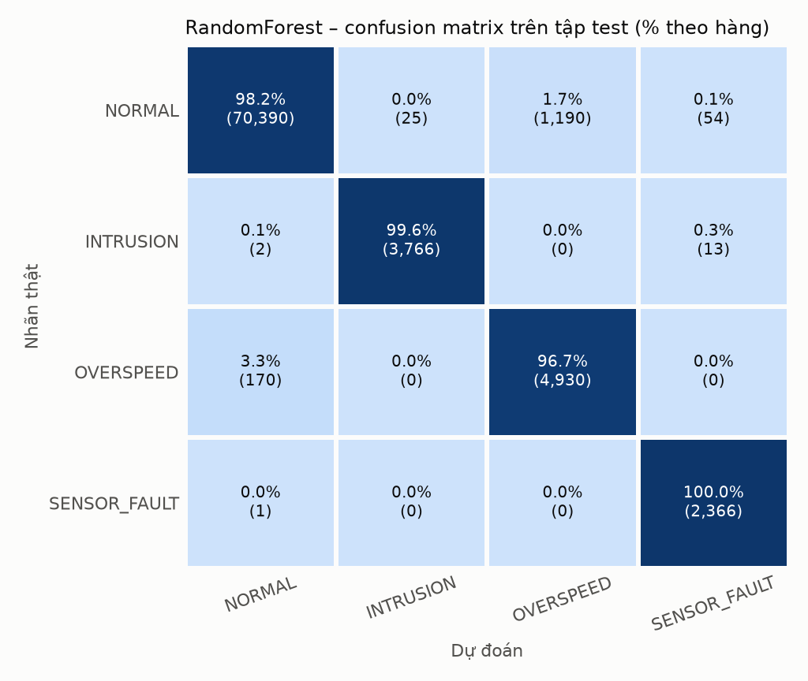
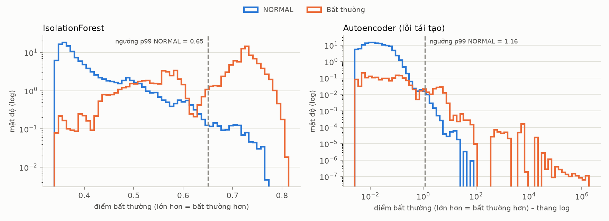
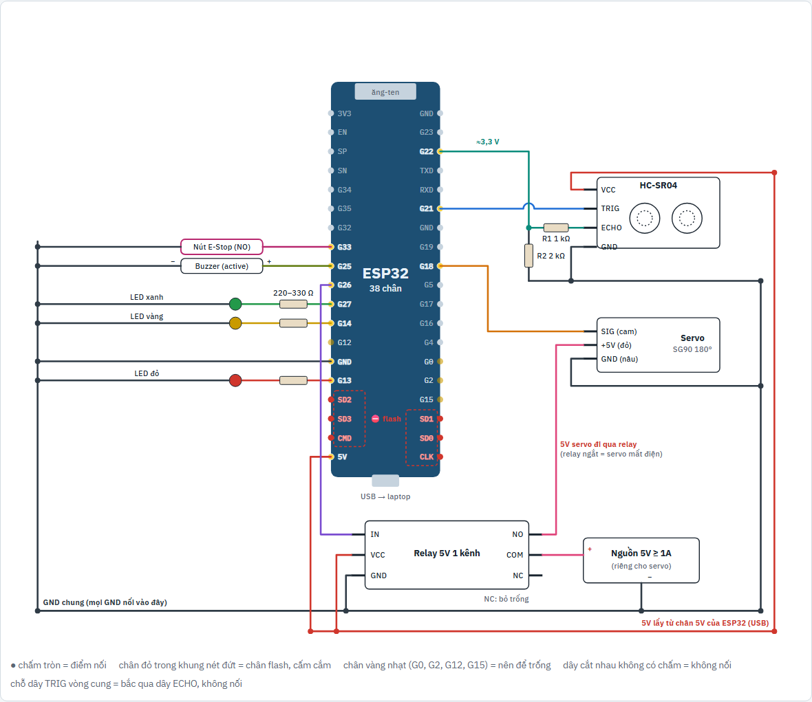
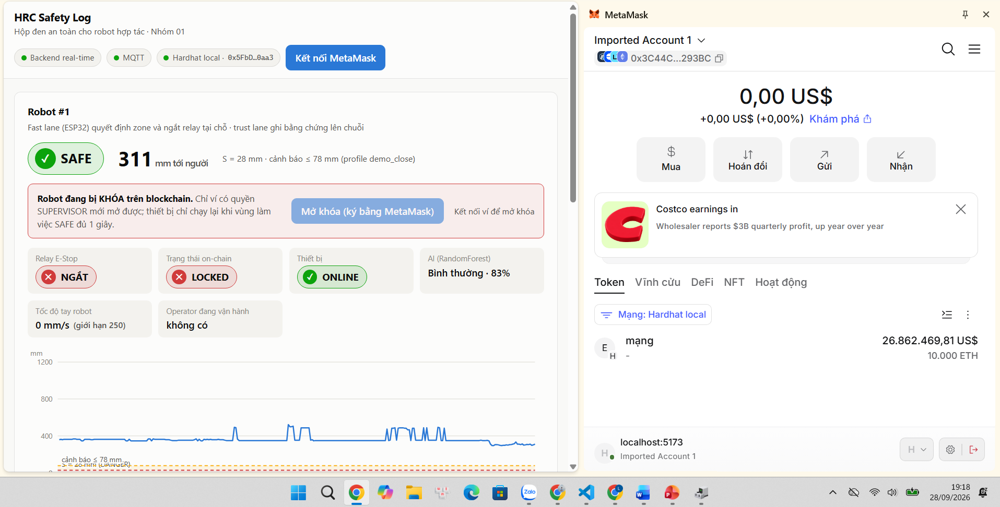

# HRC Safety Log – Hộp đen an toàn và định danh cho robot hợp tác

Đồ án cuối kỳ môn **Cơ sở Blockchain và Ứng dụng**, Đề tài 2, **Nhóm 01**. GVHD: Huỳnh Thế Thiện.

Hệ thống CPS 3 tầng **IoT → AI → Blockchain** cho không gian làm việc chung giữa người và robot hợp tác (cobot):
- **ESP32 + cảm biến siêu âm HC-SR04** tự dừng robot khi người vào vùng nguy hiểm, theo luật Speed & Separation Monitoring (ISO/TS 15066).
- **AI** phân biệt người thật với cảm biến báo sai, nên robot không bị khóa oan.
- **Smart contract** lưu bằng chứng không sửa được (Merkle root của log), khóa robot khi có sự cố, khóa quyền operator vi phạm. **Chỉ SUPERVISOR** ký mới mở khóa được.

Hệ thống đã chạy trọn vòng trên **mạch ESP32 thật**, blockchain Hardhat local và ví MetaMask:


## Mục lục

1. [Kiến trúc hai luồng](#1-kiến-trúc-hai-luồng)
2. [Đáp ứng yêu cầu đồ án](#2-đáp-ứng-yêu-cầu-đồ-án)
3. [Kết quả chính](#3-kết-quả-chính)
4. [Cấu trúc repo](#4-cấu-trúc-repo)
5. [Cài đặt và cấu hình](#5-cài-đặt-và-cấu-hình)
6. [Chạy demo trên mạch thật](#6-chạy-demo-trên-mạch-thật-esp32--hc-sr04)
7. [Chạy bằng mô phỏng](#7-chạy-bằng-mô-phỏng-không-cần-phần-cứng)
8. [Chạy trên Sepolia](#8-chạy-trên-sepolia-testnet)
9. [Kiểm thử](#9-kiểm-thử)
10. [Xử lý lỗi thường gặp](#10-xử-lý-lỗi-thường-gặp)
11. [Giới hạn và hướng phát triển](#11-giới-hạn-và-hướng-phát-triển)
12. [Nhóm 01](#12-nhóm-01)

---

## 1. Kiến trúc hai luồng



```
                        FAST LANE – an toàn, mili-giây, KHÔNG cần mạng
  HC-SR04 ─► ESP32: SSM (ISO/TS 15066) ─► DANGER? ─► NGẮT RELAY (servo mất nguồn)
                │   Edge AI INT8 (cảnh báo sớm, không nằm trong vòng an toàn)
                │ MQTT + HMAC-SHA256 (telemetry 10 Hz, heartbeat 2 Hz, có ký)
                ▼       TRUST LANE – truy vết, cỡ giây
  Mosquitto ─► Backend Python ─► kiểm HMAC / chống replay ─► SQLite (log off-chain)
                │   ├─ AI: RandomForest + IsolationForest + Autoencoder
                │   │     └─ DANGER được xác nhận là người thật ─► reportIncident() ─► robot LOCKED
                │   └─ gom batch ─► Merkle root ─► anchorLog()
                ◄─ lệnh LOCK/UNLOCK (ký HMAC) ◄─ nghe event EmergencyStop / Unlocked ◄─┘
  Dashboard (React + ethers + MetaMask): đọc chuỗi trực tiếp, SUPERVISOR ký unlock()
```

**Blockchain không nằm trong vòng điều khiển an toàn.** Mạng hoặc chuỗi chậm, thậm chí sập, thì robot vẫn dừng kịp. Chuỗi đóng 2 vai:
- **Hộp đen:** log bị sửa là phát hiện được.
- **Trọng tài:** phân quyền, khóa/mở robot, và lưu lại ai chịu trách nhiệm.

**ESP32 không nói chuyện trực tiếp với blockchain.** Nó chỉ gửi và nhận tin qua Mosquitto; backend là cầu nối. Vì vậy blockchain chạy `localhost` trên laptop là đủ.

## 2. Đáp ứng yêu cầu đồ án

| Yêu cầu | Đáp ứng | Bằng chứng |
|---|---|---|
| End-to-end IoT → AI → Smart Contract | ✅ | `scripts/e2e_local.py`: 35/35 kiểm tra; chạy trọn vòng trên mạch thật |
| Smart contract Solidity, deploy local + testnet | ✅ local ·| Hardhat 3 + Ignition; `scripts/deploy_sepolia.py` đã tập dượt trọn đường Sepolia trên node local |
| Kết nối AI với contract bằng web3.py / ethers.js | ✅ | backend dùng web3.py v7, dashboard dùng ethers v6 |
| Báo cáo PDF + demo | ✅ | `Report_Nhom01.pdf`; hướng dẫn demo ở [mục 6](#6-chạy-demo-trên-mạch-thật-esp32--hc-sr04) và [mục 7](#7-chạy-bằng-mô-phỏng-không-cần-phần-cứng) |
| **Sáng tạo: phần cứng thật** | ✅ | ESP32 38 chân + HC-SR04 + relay + servo; khóa/mở robot qua blockchain đã chạy trên mạch |
| **Sáng tạo: Edge AI INT8 trên ESP32** | ✅ | Autoencoder INT8 6,9 KB chạy trên chip; **trùng từng bit** TFLite |
| **Sáng tạo: Dashboard + MetaMask** | ✅ | SUPERVISOR ký mở khóa từ giao diện; kiểm bằng Playwright và trên mạch thật |

## 3. Kết quả chính

| Hạng mục | Số liệu |
|---|---|
| Smart contract | 50/50 test (45 mocha + 5 fuzz × 256 lần), **coverage 100%** |
| Gas `anchorLog` (batch 256 bản ghi) | 84.540 gas. **1 ca 8 giờ: 1.125 tx ≈ 0,095 ETH**; ghi từng dòng ≈ 24,35 ETH (@1 gwei), rẻ hơn khoảng 256 lần |
| AI xác nhận DANGER | **precision 1,000 / recall 1,000, 0 sự cố giả** (luật đơn thuần: 154 sự cố giả) |
| AI phân loại / phát hiện bất thường | Random Forest accuracy 0,983; Autoencoder F1 0,952, ROC-AUC 0,989 |
| Edge AI INT8 | file 6.952 B; trọng số giảm 2,3 lần; quyết định trùng bản float 99,7% |
| Firmware ESP32 | build không cảnh báo; RAM 14,1%, flash 61,2% |
| Độ trễ trust lane (DANGER → LOCK, chuỗi local) | khoảng 0,3–1,1 s. Fast lane đã ngắt relay tại ESP32 **trước đó** |
| Kiểm thử tự động | 201 pytest + 2 test giao diện + 35/35 end-to-end; mutation test bắt được 100% lỗi cài vào |
| Demo mạch thật | robot khóa khi tay < 5 cm; **operator thử mở bị contract từ chối**; supervisor mở bằng MetaMask thì chạy lại |
| Gas đo trên mạch thật (buổi 4 phút, `scripts/chi_phi_gas.py`) | 28 `anchorLog` TB 85.177 gas · `reportIncident` 122.235 · `unlock` 33.279; triển khai 1 lần 1.880.654 gas. Cấu hình mặc định ≈ 0,095 ETH/ca 8 giờ (@1 gwei) |

<table>
<tr>
<td></td>
<td></td>
</tr>
<tr>
<td align="center"><i>Ma trận nhầm lẫn của Random Forest trên tập test</i></td>
<td align="center"><i>Điểm bất thường: dữ liệu bình thường (xanh) và bất thường (cam)</i></td>
</tr>
</table>

Chi tiết từng tầng: [contracts](contracts/README.md) · [AI](ai_model/README.md) · [IoT + firmware](iot_code/README.md) · [backend](backend/README.md) · [dashboard](dashboard/README.md)

## 4. Cấu trúc repo

| Thư mục | Nội dung |
|---|---|
| [contracts/](contracts/) | `HRCSafetyLog.sol` (OpenZeppelin AccessControl + MerkleProof), test Hardhat, module Ignition |
| [ai_model/](ai_model/) | Sinh dataset, huấn luyện, đánh giá, lượng tử INT8; **trọng số đã huấn luyện** ở `models/` |
| [iot_code/](iot_code/) | Firmware ESP32 (PlatformIO) + simulator Python (chạy đúng logic firmware) |
| [backend/](backend/) | Nhận MQTT, AI, gom batch Merkle, web3.py, nghe event, API FastAPI + WebSocket |
| [dashboard/](dashboard/) | Vite + React + ethers + MetaMask; ảnh chụp và sơ đồ mạch ở `dashboard/screenshots/`, `dashboard/so_do_mach.html` |
| [scripts/](scripts/) | demo, sửa log thử (tamper), đối soát, deploy Sepolia, e2e, sinh cấu hình, đo độ trễ |
| [config/hrc_config.toml](config/hrc_config.toml) | **Cấu hình dùng chung duy nhất** (SSM, chu kỳ, batch, chính sách sự cố…) |
| [hrc_common/](hrc_common/) | Giao thức (HMAC, parse chặt), Merkle, SSM – dùng chung cho Python |
| [tests/](tests/) | pytest cho toàn hệ thống (kể cả logic firmware C++ biên dịch bằng g++) |
| `Report_Nhom01.pdf` | Báo cáo kỹ thuật |

Nhãn git `v1-simulator` giữ bản mô phỏng ban đầu (dùng cảm biến VL53L0X, trước khi làm phần cứng).

## 5. Cài đặt và cấu hình

### 5.1. Cài phần mềm (Windows)

```powershell
winget install -e --id Git.Git
winget install -e --id Python.Python.3.11
winget install -e --id OpenJS.NodeJS.LTS               # Node ≥ 22 (Hardhat 3, Vite 8)
winget install -e --id EclipseFoundation.Mosquitto

git clone D:\Blockchain\Report_CK ; cd D:\Blockchain\Report_CK
py -3.11 -m venv .venv ; .\.venv\Scripts\Activate.ps1
pip install -e ".[dev,ai]"                             # ai = TensorFlow (~300 MB), chỉ cần khi huấn luyện lại
python -m playwright install chromium                  # chỉ cần cho test giao diện
cd contracts ; npm install ; cd ..
cd dashboard ; npm install ; cd ..
```

Nếu PowerShell báo *"running scripts is disabled"*: chạy `Set-ExecutionPolicy -Scope CurrentUser RemoteSigned` một lần. Phần cứng cần thêm PlatformIO (xem [iot_code/README](iot_code/README.md)).

### 5.2. Cấu hình

```powershell
Copy-Item .env.example .env
python -c "import secrets; print(secrets.token_hex(32))"    # -> dán vào HRC_HMAC_KEY_HEX
```

Điền `ADMIN/DEVICE/SUPERVISOR/OPERATOR/AUDITOR_PRIVATE_KEY` bằng khóa **công khai** Hardhat #0–#4, lấy từ output của `npx hardhat node`. Các khóa này chỉ dùng cho chuỗi local, không nạp tiền thật.

Tham số hệ thống nằm trong [config/hrc_config.toml](config/hrc_config.toml). Bộ thông số đang dùng là `demo_close`: **dừng khi tay dưới 5 cm, cảnh báo dưới 10 cm** (ở tốc độ 150 mm/s). Đây là thông số để trình diễn trên mô hình bàn, **không** phải khoảng cách an toàn theo ISO/TS 15066. Sửa config xong phải chạy `python scripts/gen_config.py` để sinh lại header firmware và file tham số contract; AI tự sinh lại dữ liệu khi huấn luyện lại.

---

## 6. Chạy demo trên mạch thật (ESP32 + HC-SR04)

Quy trình này **đã chạy thành công** trên máy nhóm ngày 28/09/2026. Mỗi bước có 3 phần:
- **Làm gì:** lệnh cần gõ.
- **Vì sao:** bước đó phục vụ phần nào của mô hình.
- **✅ Đúng khi:** dấu hiệu để biết đã làm đúng; chưa đúng thì **dừng lại sửa**, đừng làm tiếp.

Dùng **Command Prompt (cmd)**, trừ khi ghi là *cmd Admin*. Khi chép lệnh, **chỉ chép các dòng lệnh bên trong khung**, gõ **từng dòng một**.

### 6.1. Phần cứng và sơ đồ đấu dây



| Linh kiện | Chân ESP32 | Ghi chú |
|---|---|---|
| HC-SR04 TRIG | G21 | Nối thẳng |
| HC-SR04 ECHO | G22 | **Bắt buộc qua cầu chia áp 1 kΩ / 2 kΩ** (ECHO ra 5 V, ESP32 chỉ chịu 3,3 V) |
| HC-SR04 VCC / GND | 5V / GND | Cảm biến cần 5 V |
| Servo SG90 **180°** (tín hiệu) | G18 | Nguồn 5 V riêng ≥ 1 A, đi qua tiếp điểm **NO** của relay |
| Relay 5 V một kênh (IN) | G26 | Relay hút = robot được chạy; mất điện là relay nhả |
| Nút E-Stop (tiếp điểm **NO**) | G33 | Nhấn = nối chân xuống GND |
| Buzzer | G25 | Kêu khi DANGER hoặc khi nhấn E-Stop |
| LED xanh / vàng / đỏ | G27 / G14 / G13 | Có điện trở 220–330 Ω |

Board ESP32 NodeMCU **38 chân**: cắm theo **chữ in cạnh chân** (G21, G22…), không đếm vị trí. **Không cắm gì vào CMD, CLK, SD0–SD3** (chân của chip flash) và để trống G0, G2, G12, G15, TXD, RXD, 3V3.

Ngưỡng an toàn (profile `demo_close`, tốc độ 150 mm/s):

| Vùng | Khoảng cách | Robot |
|---|---|---|
| 🔴 DANGER | ≤ 5 cm | ngắt relay ngay, còi kêu |
| 🟡 WARNING | 5–10 cm | giảm tốc còn 50% |
| 🟢 SAFE | > 10 cm | chạy bình thường |

ESP32 còn tự dừng robot khi: cảm biến không phản hồi, mất MQTT quá 2 giây, nhấn E-Stop, robot bị khóa trên blockchain (lưu NVS, rút điện vẫn khóa), tác vụ an toàn treo quá 5 giây (watchdog), hoặc mất điện (relay tự nhả).

### 6.2. Dữ liệu đi đường nào

```
 MẠCH THẬT                               LAPTOP (cùng hotspot Wi-Fi)
 HC-SR04 ─► ESP32 ─► relay ─► servo       Mosquitto :1883 ─► backend ─► Hardhat node :8545
   (ESP32 tự dừng robot, không chờ ai)      (bưu điện)        (AI, Merkle)  (blockchain, contract)
         │  MQTT qua Wi-Fi  ─────────────►  │
         ◄──────────────── LOCK / UNLOCK ◄──┘   dashboard (trình duyệt) + MetaMask (ví supervisor)
```

### 6.3. Cài đặt một lần

| # | Việc | Vì sao |
|---|---|---|
| A1 | Cài **driver CP210x** (Silicon Labs) | Board dùng chip USB CP2102. Thiếu driver thì Windows không tạo cổng COM, không nạp code được |
| A2 | Mở tường lửa cổng 1883 (cmd Admin): `netsh advfirewall firewall add rule name="MQTT 1883" dir=in action=allow protocol=TCP localport=1883` | Cho ESP32 gửi tin tới Mosquitto trên laptop |
| A3 | Tạo `secrets.h` + nạp firmware có mạng (xem [6.7](#67-đổi-mạng-wi-fi-hoặc-ip-laptop-thay-đổi)) | Tên, mật khẩu Wi-Fi và IP laptop được **ghi thẳng vào firmware**. ESP32 không có màn hình để chọn Wi-Fi |
| A4 | Cài **MetaMask**, nhập tài khoản Hardhat #2 (`0x3C44…93BC`) | Đây là ví SUPERVISOR, **người duy nhất được mở khóa robot** |

### 6.4. Chạy demo từ đầu (mỗi buổi)

Cần **6 cửa sổ**: 1 cmd Admin + 4 cmd thường + trình duyệt. Làm **đúng thứ tự** B1 → B8.

#### B1. Nối mạng: laptop vào hotspot điện thoại

**Làm gì:**
1. Điện thoại bật **hotspot** của nhóm (iPhone: bật **"Tối đa hóa tính tương thích"** để phát 2,4 GHz).
2. Laptop kết nối Wi-Fi đó.
3. Mở cmd, gõ `ipconfig`. Xem dòng **IPv4 Address** dưới mục **Wireless LAN adapter Wi-Fi**.

**Vì sao:**
- ESP32 và laptop phải **cùng một mạng** mới gửi tin cho nhau được. ESP32 chỉ bắt được **2,4 GHz**.
- Wi-Fi công cộng thường **chặn các máy nói chuyện với nhau**, nên dùng hotspot riêng.
- Hotspot phải có **4G/Internet**: ESP32 cần lấy **giờ chuẩn** (NTP) để ghi thời gian cho dữ liệu và kiểm tra lệnh LOCK/UNLOCK.

**✅ Đúng khi:** IPv4 **trùng IP đã ghi trong firmware** (máy nhóm: `172.20.10.5`). Nếu **khác**, làm [6.7](#67-đổi-mạng-wi-fi-hoặc-ip-laptop-thay-đổi) trước.

#### B2. Bật "bưu điện" MQTT cho ESP32 (cửa sổ 1, **cmd Admin**)

**Làm gì:** chuột phải *Command Prompt* → **Run as administrator**, rồi gõ:
```bat
net stop mosquitto
sc query mosquitto
cd /d D:\Blockchain\Report_CK
"C:\Program Files\mosquitto\mosquitto.exe" -c infra\mosquitto\mosquitto.native.conf -v
```
Dòng `STATE` của `sc query` phải là **`1  STOPPED`**. **Để nguyên cửa sổ này** suốt buổi demo.

**Vì sao:**
- **Mosquitto** là "bưu điện" chuyển tin giữa ESP32 và backend.
- Bản cài sẵn chạy ngầm (service) **chỉ nhận thư từ chính laptop**, nên phải tắt nó, rồi chạy bản cấu hình `mosquitto.native.conf` **nhận thư từ cả mạng Wi-Fi**.
- **Chỉ được có MỘT Mosquitto.** Nếu service còn chạy, ESP32 vào Mosquitto của bạn còn backend vào service; hai bên không thấy nhau và dashboard báo OFFLINE.

**✅ Đúng khi:** thấy `Opening ipv4 listen socket on port 1883`, không có dòng Error.

#### B3. Cấp điện cho mạch

**Làm gì:**
1. Cắm **USB** của ESP32 vào laptop.
2. Bật **nguồn 5V ngoài** cho servo.
3. Để **trống phía trước cảm biến** ít nhất 15 cm.

**Vì sao:** firmware **đã nạp sẵn**, nên cắm điện là ESP32 tự vào Wi-Fi và tự kết nối Mosquitto; **không cần nạp lại code mỗi buổi**. Phía trước phải trống vì robot chỉ chạy khi **vùng SAFE liên tục 1 giây**.

**✅ Đúng khi:**
- cửa sổ Mosquitto hiện `New client connected from 172.20.10.10 as hrc-esp32-1`;
- khoảng 1 giây sau: **relay kêu "tách", LED xanh, servo bắt đầu quay**.

Trước khi nối được Mosquitto, relay **ngắt** và servo **đứng yên**. Đó là đúng thiết kế: **mất mạng quá 2 giây là tự dừng**.

#### B4. Bật blockchain (cửa sổ 2)

**Làm gì:**
```bat
cd /d D:\Blockchain\Report_CK\contracts
npx hardhat node
```
**Để nguyên cửa sổ này.**

**Vì sao:** dựng một **blockchain Ethereum chạy ngay trên laptop** (`127.0.0.1:8545`), có sẵn 20 ví, mỗi ví 10.000 ETH thử nghiệm. Nhanh, miễn phí, chỉ tồn tại khi cửa sổ còn mở.

**✅ Đúng khi:** thấy `Started HTTP and WebSocket JSON-RPC server at http://127.0.0.1:8545/`. Nếu báo `EADDRINUSE … 8545` thì đã có blockchain chạy sẵn; dùng luôn nó.

#### B5. Đưa smart contract lên blockchain, rồi bật backend (cửa sổ 3)

**Làm gì:**
```bat
cd /d D:\Blockchain\Report_CK\contracts
npx hardhat ignition deploy ignition/modules/HRCSafetyLog.ts --network localhost --reset
cd ..
.venv\Scripts\activate.bat
hrc-backend --batch-interval-ms 8000 --db backend\data\hrc_log_hw.sqlite3
```
**Để nguyên cửa sổ này.**

**Vì sao, từng lệnh:**

| Lệnh | Làm gì | Vì sao |
|---|---|---|
| `ignition deploy … --reset` | **Deploy** contract `HRCSafetyLog`, cấp 4 vai trò (DEVICE, SUPERVISOR, OPERATOR, AUDITOR), đăng ký robot 1 | Blockchain ở B4 **mới tinh** mỗi lần bật, phải đưa contract lên lại |
| `activate.bat` | Bật môi trường Python của dự án | Để gõ được lệnh `hrc-backend` |
| `hrc-backend …` | Nhận tin từ ESP32 → kiểm chữ ký HMAC → AI phân tích → ghi log → neo lên blockchain → nghe blockchain để gửi LOCK/UNLOCK | **Cầu nối** giữa mạch và blockchain |
| `--batch-interval-ms 8000` | Cứ **8 giây** gom log thành một batch, tính Merkle root, ghi lên chuỗi | Mặc định 30 giây; để 8 giây cho demo thấy nhanh |
| `--db …hrc_log_hw.sqlite3` | Dùng **database riêng** cho phần cứng | Dùng chung với log mô phỏng thì backend tưởng bản tin ESP32 là tấn công phát lại (`REPLAY`) |

**✅ Đúng khi:** cửa sổ 3 lần lượt hiện:
```
successfully deployed 🚀                       ← contract đã lên chuỗi
Mạng local (chain 31337), contract 0x5FbDB…    ← backend thấy contract
Đã kết nối broker localhost:1883               ← backend nối được Mosquitto
Robot 1 ONLINE                                 ← backend thấy ESP32
NEO batch robot 1 #1: … bản ghi … tx=0x…       ← log đầu tiên đã được niêm phong trên blockchain
```
Dòng `DB … thuộc contract khác – đã cất sang …` là **bình thường**: contract mới nên log cũ được cất sang file khác, không bị xóa. Nếu dashboard OFFLINE trong 20–30 giây đầu: ESP32 đang chờ lấy giờ chuẩn, chưa gửi dữ liệu.

#### B6. Bật dashboard (cửa sổ 4)

**Làm gì:**
```bat
cd /d D:\Blockchain\Report_CK\dashboard
npm run dev
```
Mở trình duyệt (**Chrome có MetaMask**) vào **http://localhost:5173**.

**Vì sao:** dashboard nhận số đo **real-time** từ backend. Riêng trạng thái ACTIVE/LOCKED và lịch sử sự cố thì nó **đọc thẳng từ blockchain**, không tin backend.

**✅ Đúng khi:** 3 chấm xanh **Backend real-time · MQTT · Hardhat local**; thẻ **Thiết bị: ONLINE**, vùng **SAFE**; biểu đồ chạy theo tay bạn.

#### B7. Kết nối ví SUPERVISOR

**Làm gì:**
1. Mở MetaMask, chọn tài khoản **0x3C44…93BC** và mạng **Hardhat local** (chainId 31337, RPC `http://127.0.0.1:8545`).
2. **Chỉ khi vừa bật lại blockchain ở B4:** MetaMask → **Cài đặt → Nâng cao → Xóa dữ liệu thẻ hoạt động**.
3. Trên dashboard bấm **Kết nối MetaMask** → **Kết nối**.

**Vì sao:** chỉ ví có vai trò **SUPERVISOR** mới gọi được `unlock()`; contract tự kiểm tra. Bước xóa dữ liệu hoạt động tránh lỗi `nonce too high`, vì blockchain mới bắt đầu lại từ số 0 nhưng MetaMask vẫn nhớ số thứ tự giao dịch cũ.

**✅ Đúng khi:** góc trên dashboard hiện huy hiệu **`0x3C44…93BC SUPERVISOR`**.

#### B8. Trình diễn

| # | Bạn làm | Mạch | Dashboard / backend | Giải thích khi thuyết trình |
|---|---|---|---|---|
| 1 | Để trống phía trước | LED xanh, servo quay | **SAFE**; cứ 8 s có dòng `NEO batch` | Log liên tục được niêm phong bằng **Merkle root**: 32 byte/batch lên chuỗi |
| 2 | Đưa tay vào **6–10 cm** | LED vàng, servo **chậm một nửa** | **WARNING** | Robot giảm tốc trước khi phải dừng |
| 3 | Đưa tay vào **3–5 cm**, giữ 1–2 giây | **LED đỏ, còi kêu, servo dừng ngay** | **DANGER**, khoảng 1 s sau **LOCKED** | **ESP32 tự dừng robot ngay** (fast lane). AI xác nhận người thật, contract ghi sự cố và khóa robot (trust lane) |
| 4 | Rút tay ra | Servo **vẫn đứng yên**, LED đỏ nhấp nháy | vẫn **LOCKED** | Robot bị khóa **trên blockchain**, người rời đi cũng không tự chạy lại |
| 5 | Ví **OPERATOR** thử mở khóa (lệnh bên dưới) | Servo **vẫn đứng yên** | Lỗi `AccessControlUnauthorizedAccount` | **Chỉ SUPERVISOR mở được.** Contract chặn ngay, kể cả gọi thẳng blockchain; admin cũng bị từ chối |
| 6 | Bấm **Mở khóa (ký bằng MetaMask)** → **Xác nhận** | 1–2 s sau: relay tách, **servo quay lại** | **ACTIVE**, dòng *"Đã mở khóa – giao dịch 0x…"* | **Giao dịch ghi vĩnh viễn ai mở, lúc nào** |
| 7 | Nhấn nút **E-Stop** | Dừng ngay, còi kêu | relay NGẮT | Dừng khẩn cấp bằng tay |

<table>
<tr>
<td></td>
<td></td>
</tr>
<tr>
<td align="center"><i>Bước 3–4: tay vào dưới 5 cm, relay NGẮT, chuỗi LOCKED</i></td>
<td align="center"><i>Bước 6: supervisor ký unlock bằng MetaMask, robot ACTIVE</i></td>
</tr>
</table>

**Lệnh cho bước 5** (cmd, khi robot đang LOCKED):
```bat
cd /d D:\Blockchain\Report_CK
.venv\Scripts\activate.bat
python -c "from hrc_backend.chain import ChainClient; ChainClient.from_env('OPERATOR').unlock(1)"
```
✅ Đúng khi báo `unlock bị từ chối: AccessControlUnauthorizedAccount(account=0x90f7…, …)` và servo không chạy lại. Muốn diễn trên MetaMask: nhập ví OPERATOR (Hardhat #3, khóa thử nghiệm công khai `0x7c852118294e51e653712a81e05800f419141751be58f605c371e15141b007a6`), chọn tài khoản `0x90F7…` rồi kết nối lại dashboard. **Không có** huy hiệu SUPERVISOR, và nút Mở khóa bị mờ.

**Không đưa tay sát dưới 3 cm:** HC-SR04 có vùng mù, quá gần sẽ đo sai.

**Màn "sửa log thì bị phát hiện"** (cửa sổ 5, sau vài phút có dữ liệu):
```bat
cd /d D:\Blockchain\Report_CK
.venv\Scripts\activate.bat
python scripts\tamper_demo.py --db backend\data\hrc_log_hw.sqlite3
```
Script cố tình sửa một dòng log (đổi DANGER thành SAFE để che sự cố), tính lại Merkle root và so với root **đã nằm trên blockchain**: lệch. Chữ ký HMAC của ESP32 chỉ ra **đúng dòng bị sửa**. Cuối cùng script tự khôi phục dòng đã sửa.
**Kiểm tra chi phí gas** (khi demo được từ 3 phút, blockchain vẫn đang chạy):
```bat
cd /d D:\Blockchain\Report_CK
.venv\Scripts\activate.bat
python scripts\chi_phi_gas.py --eth-usd 2500
```

### 6.5. Kết thúc buổi demo

1. `Ctrl+C` ở cửa sổ 4 (dashboard) → cửa sổ 3 (backend) → cửa sổ 2 (blockchain).
2. Tắt **nguồn 5V servo**, rút **USB** ESP32. Relay tự nhả.
3. Cửa sổ 1 (cmd Admin): `Ctrl+C` để tắt Mosquitto.
4. **(Tùy chọn)** Muốn chạy bản mô phỏng ngay mà không khởi động lại máy: `net start mosquitto` trong **cmd Admin**.

Mosquitto service **tự bật khi mở máy**. Lần sau chạy mạch thật vẫn phải làm lại **B2**.

### 6.6. Xem ESP32 "nói" gì (Serial Monitor)

```bat
cd /d D:\Blockchain\Report_CK\iot_code\firmware
..\..\.pio-venv\Scripts\pio.exe device monitor --port COM9
```
Gõ `s` rồi Enter để xem trạng thái, ví dụ `d=332mm zone=0 estop=0() link=1 ntp=1`. Thoát: `Ctrl+C`. Cổng COM xem trong *Device Manager → Ports* (dòng *Silicon Labs CP210x*).

⚠️ **Mở Serial Monitor sẽ khởi động lại ESP32** (mất kết nối khoảng 20 giây), nên **đừng mở khi đang demo**, và phải thoát nó **trước khi nạp code**.

| `estop=1(…)` | Nghĩa là | Làm gì |
|---|---|---|
| `DANGER` | có vật dưới 5 cm | rút tay / dọn vật cản |
| `LOCKED` | bị khóa trên blockchain | Supervisor mở khóa |
| `BUTTON` | nút E-Stop đang nhấn | xoay nút nhả ra |
| `LINK_LOST` | chưa nối được Mosquitto | kiểm B1–B2 (hotspot, IP, Mosquitto) |
| `SENSOR` | HC-SR04 không phản hồi | kiểm dây TRIG G21, ECHO G22, 5V, cầu chia áp |
| `BOOT` | vừa khởi động, chờ SAFE đủ 1 giây | dọn trống phía trước cảm biến |

### 6.7. Đổi mạng Wi-Fi hoặc IP laptop thay đổi

**Làm gì:**
1. Laptop vào mạng mới, `ipconfig` lấy IPv4 mới (ví dụ `192.168.43.10`).
2. **Tắt nguồn 5V servo** (nạp code lúc servo chạy dễ lỗi sụt nguồn).
3. Tạo lại file bí mật và nạp lại firmware:
   ```bat
   cd /d D:\Blockchain\Report_CK
   .venv\Scripts\activate.bat
   python scripts\make_secrets_h.py --ssid "TenWifi" --password "MatKhau" --mqtt-host 192.168.43.10
   cd iot_code\firmware
   ..\..\.pio-venv\Scripts\pio.exe run -e esp32dev -t upload --upload-port COM9
   ```

**Vì sao:** tên Wi-Fi, mật khẩu và IP laptop nằm **trong firmware**. `make_secrets_h.py` tự lấy khóa HMAC từ `.env`, nên ESP32 và backend luôn dùng **cùng một khóa**. Luôn ghi rõ `--mqtt-host` vì script tự dò IP có thể lấy nhầm card mạng ảo. File `secrets.h` bị Git bỏ qua, không bao giờ lên GitHub.

Muốn thử relay và servo **không cần mạng**: nạp bản `-e esp32dev_bench` thay cho `-e esp32dev`.

---

## 7. Chạy bằng mô phỏng (không cần phần cứng)

Mosquitto dùng service mặc định của Windows. Mở 4 terminal (đã kích hoạt `.venv`):

```powershell
# 1) Blockchain local (giữ chạy)
cd contracts ; npx hardhat node
# 2) Deploy contract (mỗi lần khởi động lại node), rồi chạy backend ở cùng terminal
cd contracts ; npx hardhat ignition deploy ignition/modules/HRCSafetyLog.ts --network localhost --reset ; cd ..
hrc-backend --batch-interval-ms 8000       # ingest + AI + blockchain + API/WebSocket (cổng 8000)
# 3) Dashboard: http://localhost:5173 -> "Kết nối MetaMask" (ví SUPERVISOR = Hardhat #2)
cd dashboard ; npm run dev
# 4) Robot mô phỏng: kịch bản demo có lời dẫn, hoặc tự chạy từng kịch bản
python scripts/demo_scenario.py            # thêm --pause để dừng giữa các bước, --auto-unlock nếu không dùng MetaMask
hrc-sim --scenario approach --duration 30  # các kịch bản: normal, approach, overspeed, sensor_noise, mixed
```

Công cụ riêng lẻ:

```powershell
python scripts/tamper_demo.py --record-audit   # sửa 1 dòng log -> bị phát hiện; auditor ghi kết quả lên chuỗi
python scripts/verify_log.py                   # đối soát toàn bộ log với Merkle root on-chain
python scripts/thuc_hanh_contract.py           # tự tay gọi từng hàm của contract, có giải thích
```

## 8. Chạy trên Sepolia (testnet)

1. **Chuẩn bị:** RPC Sepolia (Alchemy/Infura), ví MetaMask **chỉ dùng để test** có khoảng 0,05 SepoliaETH từ faucet, API key Etherscan (tùy chọn).
2. **Cấu hình:** `Copy-Item .env.sepolia.example .env.sepolia`, điền `SEPOLIA_RPC_URL`, `SEPOLIA_PRIVATE_KEY`, `SUPERVISOR_ADDRESS`. **Không xóa các dòng để trống** trong file, và không commit file này.
3. **Deploy:**
   ```powershell
   python scripts/deploy_sepolia.py --dry-run-local   # tập dượt trên node local trước
   python scripts/deploy_sepolia.py --verify          # deploy thật + verify mã nguồn trên Etherscan
   ```
   Script kiểm số dư, từ chối nếu vai trò rơi vào ví Hardhat công khai, deploy qua Ignition, kiểm vai trò trên chuỗi, rồi ghi `CONTRACT_ADDRESS` vào `.env.sepolia`.
4. **Chạy:** `$env:HRC_NETWORK = "sepolia"` rồi `hrc-backend`. Dashboard tự hiện link Etherscan cho mọi giao dịch.

Trên Sepolia mỗi khối mất khoảng 12 s, nên sự cố xuất hiện trên chuỗi sau khoảng 15–30 s; fast lane vẫn ngắt relay tức thì.

## 9. Kiểm thử

```powershell
python -m pytest                    # 201 test: giao thức, ingest, simulator, AI, Merkle, backend, API, firmware C++ (g++)…
python -m pytest -m ui              # 2 test giao diện dashboard (Playwright) – chạy RIÊNG
python scripts/e2e_local.py         # nghiệm thu end-to-end: 35 kiểm tra (cần hardhat node + Mosquitto)
cd contracts ; npx hardhat test --gas-stats --coverage
cd iot_code/firmware ; ..\..\.pio-venv\Scripts\pio.exe run     # build firmware ESP32
```

Test cần Hardhat node, broker, g++ hoặc TensorFlow sẽ **tự bỏ qua** (có ghi lý do) khi thiếu điều kiện. **Không chạy test MQTT hoặc e2e song song với một demo khác**, vì tất cả dùng chung topic `hrc/1/*`.

## 10. Xử lý lỗi thường gặp

**Phần mềm / blockchain**

| Hiện tượng | Nguyên nhân / cách xử lý |
|---|---|
| `Không có contract ở 0x… (node đã khởi động lại?)` | Hardhat node mất trạng thái khi khởi động lại. Deploy lại: `ignition deploy ... --network localhost --reset` |
| Backend log `DB … thuộc contract khác – đã cất sang …` | Bình thường sau khi deploy lại. DB cũ được **cất** sang file khác, không bị xóa |
| `HRC_HMAC_KEY_HEX phải là 64 ký tự hex` | Chưa điền khóa HMAC trong `.env` |
| MetaMask báo `nonce too high` | Chuỗi local đã reset. MetaMask → Cài đặt → Nâng cao → *Xóa dữ liệu thẻ hoạt động* |
| Dashboard báo *"Không tìm thấy MetaMask"* | Trình duyệt chưa cài MetaMask |
| Nút Mở khóa mờ, ghi *"Kết nối ví để mở khóa"* | Chưa bấm Kết nối MetaMask, hoặc đang chọn tài khoản không phải SUPERVISOR |
| Mở khóa xong robot lại bị khóa | Tay/người vẫn ở vùng nguy hiểm, nên AI ghi sự cố mới. Rút ra xa hơn 10 cm rồi mới mở khóa |
| Backend `LOẠI [REPLAY]` liên tục | Dùng chung database giữa mô phỏng và mạch thật. Chạy backend với `--db` riêng |

**Phần cứng** (các lỗi nhóm đã thực sự gặp)

| Hiện tượng | Nguyên nhân | Cách xử lý |
|---|---|---|
| Không thấy cổng COM của ESP32 (chỉ thấy cổng Bluetooth) | Thiếu driver CP210x | Cài driver Silicon Labs |
| Nạp code báo `Packet content transfer stopped` / `chip stopped responding` | Servo/relay làm sụt nguồn USB lúc ghi flash | Tắt nguồn servo, rút dây 5V relay khi nạp (tốc độ nạp đã hạ xuống 115200) |
| Board lặp `flash read err, 988` | Board 38 chân nhưng dây rơi vào chân flash | **Không cắm gì vào CMD, CLK, SD0–SD3**; cắm theo chữ in cạnh chân |
| Còi kêu liên tục, `estop=1(BUTTON)` | Nút E-Stop đang nhấn / đấu nhầm tiếp điểm NC | Xoay nút nhả ra; dùng khối tiếp điểm **NO** (xanh lá, số 13–14) |
| Servo không quay, `LINK_LOST` | Firmware có mạng mà chưa nối Mosquitto | Làm B1–B2. Muốn thử servo không cần mạng: nạp `-e esp32dev_bench` |
| Servo không quay, `BOOT` / WARNING | Có vật trong 10 cm trước cảm biến (dây, servo, mép bàn) | Dọn trống; kê cảm biến cao lên, hướng thẳng ra khoảng trống |
| Mosquitto **không bao giờ** hiện `New client connected … hrc-esp32-1` | Hotspot iPhone tự chuyển sang 5 GHz | Bật **"Tối đa hóa tính tương thích"**; rút USB ESP32 cắm lại |
| ESP32 đã kết nối nhưng backend không thấy, dashboard **OFFLINE** | **2 Mosquitto cùng chạy** (service Windows tự bật lại) | cmd Admin: `net stop mosquitto`, `sc query mosquitto` phải `STOPPED` |
| Dashboard OFFLINE 20–30 giây đầu | ESP32 chưa lấy được giờ chuẩn (NTP) | Chờ thêm; hotspot phải có 4G |
| Mosquitto báo `Only one usage of each socket address` | Đã có Mosquitto khác giữ cổng 1883 | `net stop mosquitto`, đóng cửa sổ Mosquitto cũ, chạy lại |
| `net start mosquitto` báo `System error 5 … Access is denied` | Không chạy bằng cmd Admin | Mở cmd bằng *Run as administrator* |

## 11. Giới hạn và hướng phát triển

- **Dữ liệu AI là mô phỏng.** Simulator chạy đúng logic firmware, nhưng nhiễu của HC-SR04 thật khác mô phỏng. Cần thu dữ liệu thật và huấn luyện lại.
- **Ngưỡng 5 cm chỉ để trình diễn**, chưa theo ISO/TS 15066. Cần đo độ trễ thật (`scripts/measure_latency.py`) và hiệu chỉnh tham số.
- **Lỗi trôi dần của 1 cảm biến không phát hiện được.** Cần cảm biến thứ hai để đối chiếu (kênh kép, ISO 13849).
- **Oracle problem:** chuỗi chỉ đảm bảo log *không bị sửa sau khi ghi*, không đảm bảo cảm biến nói thật. Hướng nâng cấp: chip bảo mật hoặc TEE giữ khóa thiết bị.
- **An toàn chức năng:** đây là mô hình học tập, **chưa được chứng nhận an toàn**. Relay và ESP32 không phải thiết bị an toàn đạt chuẩn.
- **API backend chưa có xác thực**, chỉ nghe `127.0.0.1`. Hướng: SIWE + HTTPS; mở khóa có thể nâng thành multisig 2-of-N; triển khai thật nên dùng Layer 2 để giảm phí.

## 12. Nhóm 01

| Thành viên | Phụ trách |
|---|---|
| Đinh Thiện Vinh | IoT & firmware: lắp mạch, firmware SSM, fail-safe, MQTT có ký |
| Đoàn Nguyễn Hoàng MInh | AI: dữ liệu, Random Forest, Isolation Forest, Autoencoder, Edge AI INT8 |
| Lê Văn Lương (Nhóm trưởng) | Smart contract: HRCSafetyLog, kiểm thử, deploy, metamask, slide |
| Nguyễn Hồ Minh Vy | Backend tích hợp: MQTT, Merkle, web3.py, xử lý sự cố |
| Nguyễn Ngọc Tú | Dashboard, MetaMask, báo cáo, |
