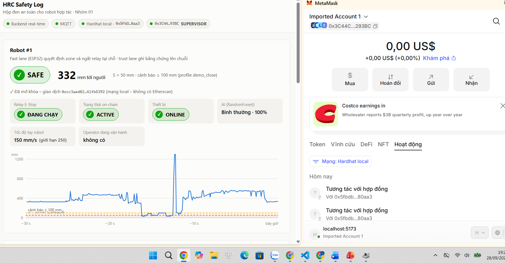

# HRC Safety Log – Hộp đen an toàn và định danh cho robot hợp tác

Đồ án cuối kỳ môn **Cơ sở Blockchain và Ứng dụng**, Đề tài 2, **Nhóm 01**. GVHD: Huỳnh Thế Thiện.

Hệ thống CPS 3 tầng **IoT → AI → Blockchain** cho không gian làm việc chung giữa người và robot hợp tác (cobot):
- **ESP32 + cảm biến siêu âm HC-SR04** tự dừng robot khi người vào vùng nguy hiểm, theo luật Speed & Separation Monitoring (ISO/TS 15066).
- **AI** phân biệt người thật với cảm biến báo sai, nên robot không bị khóa oan.
- **Smart contract** lưu bằng chứng không sửa được (Merkle root của log), khóa robot khi có sự cố, khóa quyền operator vi phạm. **Chỉ SUPERVISOR** ký mới mở khóa được.

Hệ thống đã chạy trọn vòng trên **mạch ESP32 thật**, blockchain Hardhat local và ví MetaMask:



## Kiến trúc: 2 luồng

```
                        FAST LANE – an toàn, mili-giây, KHÔNG cần mạng
  HC-SR04 ─► ESP32: SSM (ISO/TS 15066) ─► DANGER? ─► NGẮT RELAY (servo mất nguồn)
                │   Edge AI INT8 (cảnh báo sớm, không nằm trong vòng an toàn)
                │ MQTT + HMAC-SHA256 (telemetry 10 Hz, heartbeat 2 Hz, có ký)
                ▼       TRUST LANE – truy vết, cỡ giây
  Mosquitto ─► Backend Python ─► kiểm HMAC / chống replay ─► SQLite (log off-chain)
                │   ├─ AI: RandomForest + IsolationForest + Autoencoder
                │   │     └─ DANGER được xác nhận là người thật ─► reportIncident() ─► robot LOCKED
                │   └─ gom batch ─► Merkle root ─► anchorLog()
                ◄─ lệnh LOCK/UNLOCK (ký HMAC) ◄─ nghe event EmergencyStop / Unlocked ◄─┘
  Dashboard (React + ethers + MetaMask): đọc chuỗi trực tiếp, SUPERVISOR ký unlock()
```

**Blockchain không nằm trong vòng điều khiển an toàn.** Mạng hoặc chuỗi chậm, thậm chí sập, thì robot vẫn dừng kịp. Chuỗi đóng 2 vai:
- **Hộp đen:** log bị sửa là phát hiện được.
- **Trọng tài:** phân quyền, khóa/mở robot, và lưu lại ai chịu trách nhiệm.

## Đáp ứng yêu cầu đồ án

| Yêu cầu | Đáp ứng | Bằng chứng |
|---|---|---|
| End-to-end IoT → AI → Smart Contract | ✅ | `scripts/e2e_local.py`: 35/35 kiểm tra; chạy trọn vòng trên mạch thật |
| Smart contract Solidity, deploy local + testnet | ✅ local · 🟡 Sepolia | Hardhat 3 + Ignition; `scripts/deploy_sepolia.py` đã tập dượt trọn đường Sepolia trên node local |
| Kết nối AI với contract bằng web3.py / ethers.js | ✅ | backend dùng web3.py v7, dashboard dùng ethers v6 |
| Báo cáo PDF + demo | ✅ | `Report_Nhom01.pdf`; hướng dẫn demo [mạch thật](docs/DEMO_PHAN_CUNG.md) và [mô phỏng](docs/HUONG_DAN_CHAY.md) |
| **Sáng tạo: phần cứng thật** | ✅ | ESP32 38 chân + HC-SR04 + relay + servo; khóa/mở robot qua blockchain đã chạy trên mạch |
| **Sáng tạo: Edge AI INT8 trên ESP32** | ✅ | Autoencoder INT8 6,9 KB, chạy trên chip; **trùng từng bit** TFLite |
| **Sáng tạo: Dashboard + MetaMask** | ✅ | SUPERVISOR ký mở khóa từ giao diện; kiểm bằng Playwright và trên mạch thật |

## Kết quả chính

| Hạng mục | Số liệu |
|---|---|
| Smart contract | 50/50 test (45 mocha + 5 fuzz × 256 lần), **coverage 100%** |
| Gas `anchorLog` (batch 256 bản ghi) | 84.540 gas. **1 ca 8 giờ: 1.125 tx ≈ 0,095 ETH**; ghi từng dòng ≈ 24,35 ETH (@1 gwei), rẻ hơn khoảng 256 lần |
| AI xác nhận DANGER | **precision 1,000 / recall 1,000, 0 sự cố giả** (luật đơn thuần: 154 sự cố giả) |
| AI phân loại / phát hiện bất thường | Random Forest accuracy 0,983; Autoencoder F1 0,952, ROC-AUC 0,989 |
| Edge AI INT8 | file 6.952 B; trọng số giảm 2,3 lần; quyết định trùng bản float 99,7% |
| Firmware ESP32 | build không cảnh báo; RAM 14,1%, flash 61,2% |
| Độ trễ trust lane (DANGER → LOCK, chuỗi local) | khoảng 0,3–1,1 s. Fast lane đã ngắt relay tại ESP32 **trước đó** |
| Kiểm thử tự động | 201 pytest + 2 test giao diện + 35/35 end-to-end; mutation test bắt được 100% lỗi cài vào |
| Demo mạch thật | robot khóa khi tay < 5 cm; **operator thử mở bị contract từ chối**; supervisor mở bằng MetaMask thì chạy lại |

Chi tiết từng tầng: [contracts](contracts/README.md) · [AI](ai_model/README.md) · [IoT + firmware](iot_code/README.md) · [backend](backend/README.md) · [dashboard](dashboard/README.md) · [interface đã chốt](docs/INTERFACES.md)

## Cấu trúc repo

| Thư mục | Nội dung |
|---|---|
| [contracts/](contracts/) | `HRCSafetyLog.sol` (OpenZeppelin AccessControl + MerkleProof), test Hardhat, module Ignition |
| [ai_model/](ai_model/) | Sinh dataset, huấn luyện, đánh giá, lượng tử INT8; **trọng số đã huấn luyện** ở `models/` |
| [iot_code/](iot_code/) | Firmware ESP32 (PlatformIO) + simulator Python (chạy đúng logic firmware) |
| [backend/](backend/) | Nhận MQTT, AI, gom batch Merkle, web3.py, nghe event, API FastAPI + WebSocket |
| [dashboard/](dashboard/) | Vite + React + ethers + MetaMask |
| [scripts/](scripts/) | demo, sửa log thử (tamper), đối soát, deploy Sepolia, e2e, sinh cấu hình, đo độ trễ |
| [config/hrc_config.toml](config/hrc_config.toml) | **Cấu hình dùng chung duy nhất** (SSM, chu kỳ, batch, chính sách sự cố…) |
| [hrc_common/](hrc_common/) | Giao thức (HMAC, parse chặt), Merkle, SSM – dùng chung cho Python |
| [tests/](tests/) | pytest cho toàn hệ thống (kể cả logic firmware C++ biên dịch bằng g++) |
| [docs/](docs/) | Hướng dẫn chạy, sơ đồ mạch, interface đã chốt, ảnh chụp |
| `Report_Nhom01.pdf` | Báo cáo kỹ thuật |

Nhãn git `v1-simulator` giữ bản mô phỏng ban đầu (dùng cảm biến VL53L0X, trước khi làm phần cứng).

## Cài đặt (Windows)

```powershell
winget install -e --id Git.Git
winget install -e --id Python.Python.3.11
winget install -e --id OpenJS.NodeJS.LTS               # Node ≥ 22 (Hardhat 3, Vite 8)
winget install -e --id EclipseFoundation.Mosquitto

git clone <repo> ; cd <repo>
py -3.11 -m venv .venv ; .\.venv\Scripts\Activate.ps1
pip install -e ".[dev,ai]"                             # ai = TensorFlow (~300 MB), chỉ cần khi huấn luyện lại
python -m playwright install chromium                  # chỉ cần cho test giao diện
cd contracts ; npm install ; cd ..
cd dashboard ; npm install ; cd ..
```

Nếu PowerShell báo *"running scripts is disabled"*: chạy `Set-ExecutionPolicy -Scope CurrentUser RemoteSigned` một lần. Phần cứng cần thêm PlatformIO (xem [iot_code/README](iot_code/README.md)) và driver USB **CP210x** của Silicon Labs.

## Cấu hình

```powershell
Copy-Item .env.example .env
python -c "import secrets; print(secrets.token_hex(32))"    # -> dán vào HRC_HMAC_KEY_HEX
```

Điền `ADMIN/DEVICE/SUPERVISOR/OPERATOR/AUDITOR_PRIVATE_KEY` bằng khóa **công khai** Hardhat #0–#4, lấy từ output của `npx hardhat node`. Các khóa này chỉ dùng cho chuỗi local, không nạp tiền thật.

Tham số hệ thống nằm trong [config/hrc_config.toml](config/hrc_config.toml). Bộ thông số đang dùng là `demo_close`: **dừng khi tay dưới 5 cm, cảnh báo dưới 10 cm** (ở tốc độ 150 mm/s). Đây là thông số để trình diễn trên mô hình bàn, **không** phải khoảng cách an toàn theo ISO/TS 15066. Sửa config xong phải chạy `python scripts/gen_config.py` để sinh lại header firmware và file tham số contract; AI tự sinh lại dữ liệu khi huấn luyện lại.

## Chạy trên mạch thật (ESP32 + HC-SR04)

> Hướng dẫn đầy đủ, giải thích từng bước và các lỗi đã gặp: **[docs/DEMO_PHAN_CUNG.md](docs/DEMO_PHAN_CUNG.md)**


| Linh kiện | Chân ESP32 |
|---|---|
| HC-SR04 TRIG / ECHO (ECHO qua cầu chia áp 1 kΩ / 2 kΩ) | G21 / G22 |
| Servo SG90 180° (nguồn 5 V riêng đi qua tiếp điểm NO của relay) | G18 |
| Relay 5 V · Nút E-Stop (NO) · Buzzer | G26 · G33 · G25 |
| LED xanh / vàng / đỏ | G27 / G14 / G13 |

Board 38 chân: **không cắm gì vào CMD, CLK, SD0–SD3** (chân của chip flash).

Tóm tắt các bước mỗi buổi demo:
1. Laptop và ESP32 cùng vào một hotspot **2,4 GHz** có Internet (ESP32 cần đồng bộ giờ NTP).
2. **cmd Admin:** `net stop mosquitto`, kiểm tra `sc query mosquitto` báo `STOPPED`, rồi chạy Mosquitto nghe cả mạng Wi-Fi:
   ```bat
   "C:\Program Files\mosquitto\mosquitto.exe" -c infra\mosquitto\mosquitto.native.conf -v
   ```
3. Cấp điện cho mạch. Cửa sổ Mosquitto phải hiện `New client connected … as hrc-esp32-1`.
4. `cd contracts ; npx hardhat node`.
5. Deploy rồi chạy backend với **database riêng cho phần cứng**:
   ```bat
   npx hardhat ignition deploy ignition/modules/HRCSafetyLog.ts --network localhost --reset
   hrc-backend --batch-interval-ms 8000 --db backend\data\hrc_log_hw.sqlite3
   ```
6. `cd dashboard ; npm run dev`, mở http://localhost:5173, kết nối MetaMask bằng ví SUPERVISOR (Hardhat #2).

Kịch bản demo: robot chạy → đưa tay vào dưới 5 cm, robot dừng và bị **LOCKED** → ví OPERATOR thử mở thì **bị contract từ chối** → SUPERVISOR ký `unlock()` trên MetaMask thì robot chạy lại.

## Chạy bằng mô phỏng (không cần phần cứng)

> Hướng dẫn chạy thủ công từng bước, kèm kết quả mong đợi: [docs/HUONG_DAN_CHAY.md](docs/HUONG_DAN_CHAY.md)

Mosquitto dùng service mặc định của Windows. Mở 4 terminal (đã kích hoạt `.venv`):

```powershell
# 1) Blockchain local (giữ chạy)
cd contracts ; npx hardhat node
# 2) Deploy contract (mỗi lần khởi động lại node), rồi chạy backend ở cùng terminal
cd contracts ; npx hardhat ignition deploy ignition/modules/HRCSafetyLog.ts --network localhost --reset ; cd ..
hrc-backend --batch-interval-ms 8000       # ingest + AI + blockchain + API/WebSocket (cổng 8000)
# 3) Dashboard: http://localhost:5173 -> "Kết nối MetaMask" (ví SUPERVISOR = Hardhat #2)
cd dashboard ; npm run dev
# 4) Robot mô phỏng: kịch bản demo có lời dẫn, hoặc tự chạy từng kịch bản
python scripts/demo_scenario.py            # thêm --pause để dừng giữa các bước, --auto-unlock nếu không dùng MetaMask
hrc-sim --scenario approach --duration 30  # các kịch bản: normal, approach, overspeed, sensor_noise, mixed
```

Công cụ riêng lẻ:

```powershell
python scripts/tamper_demo.py --record-audit   # sửa 1 dòng log -> bị phát hiện; auditor ghi kết quả lên chuỗi
python scripts/verify_log.py                   # đối soát toàn bộ log với Merkle root on-chain
python scripts/thuc_hanh_contract.py           # tự tay gọi từng hàm của contract, có giải thích
```

## Chạy trên Sepolia (testnet)

1. **Chuẩn bị:** RPC Sepolia (Alchemy/Infura), ví MetaMask **chỉ dùng để test** có khoảng 0,05 SepoliaETH từ faucet, API key Etherscan (tùy chọn).
2. **Cấu hình:** `Copy-Item .env.sepolia.example .env.sepolia`, điền `SEPOLIA_RPC_URL`, `SEPOLIA_PRIVATE_KEY`, `SUPERVISOR_ADDRESS`. **Không xóa các dòng để trống** trong file, và không commit file này.
3. **Deploy:**
   ```powershell
   python scripts/deploy_sepolia.py --dry-run-local   # tập dượt trên node local trước
   python scripts/deploy_sepolia.py --verify          # deploy thật + verify mã nguồn trên Etherscan
   ```
   Script kiểm số dư, từ chối nếu vai trò rơi vào ví Hardhat công khai, deploy qua Ignition, kiểm vai trò trên chuỗi, rồi ghi `CONTRACT_ADDRESS` vào `.env.sepolia`.
4. **Chạy:** `$env:HRC_NETWORK = "sepolia"` rồi `hrc-backend`. Dashboard tự hiện link Etherscan cho mọi giao dịch.

Trên Sepolia mỗi khối mất khoảng 12 s, nên sự cố xuất hiện trên chuỗi sau khoảng 15–30 s; fast lane vẫn ngắt relay tức thì.

## Kiểm thử

```powershell
python -m pytest                    # 201 test: giao thức, ingest, simulator, AI, Merkle, backend, API, firmware C++ (g++)…
python -m pytest -m ui              # 2 test giao diện dashboard (Playwright) – chạy RIÊNG
python scripts/e2e_local.py         # nghiệm thu end-to-end: 35 kiểm tra (cần hardhat node + Mosquitto)
cd contracts ; npx hardhat test --gas-stats --coverage
cd iot_code/firmware ; ..\..\.pio-venv\Scripts\pio.exe run     # build firmware ESP32
```

Test cần Hardhat node, broker, g++ hoặc TensorFlow sẽ **tự bỏ qua** (có ghi lý do) khi thiếu điều kiện. **Không chạy test MQTT hoặc e2e song song với một demo khác**, vì tất cả dùng chung topic `hrc/1/*`.

## Xử lý lỗi thường gặp

| Hiện tượng | Nguyên nhân / cách xử lý |
|---|---|
| `Không có contract ở 0x… (node đã khởi động lại?)` | Hardhat node mất trạng thái khi khởi động lại. Deploy lại: `ignition deploy ... --network localhost --reset` |
| Backend log `DB … thuộc contract khác – đã cất sang …` | Bình thường sau khi deploy lại. DB cũ được **cất** sang file khác, không bị xóa |
| `HRC_HMAC_KEY_HEX phải là 64 ký tự hex` | Chưa điền khóa HMAC trong `.env` |
| MetaMask báo `nonce too high` | Chuỗi local đã reset. MetaMask → Cài đặt → Nâng cao → *Xóa dữ liệu thẻ hoạt động* |
| Mở khóa xong robot lại bị khóa | Người vẫn ở vùng nguy hiểm, nên AI ghi sự cố mới. Chỉ mở khóa khi vùng SAFE |
| ESP32 kết nối Mosquitto nhưng dashboard báo OFFLINE | Có 2 Mosquitto cùng chạy (service Windows tự bật lại). `net stop mosquitto` trong cmd Admin |
| ESP32 không vào được Wi-Fi | Hotspot đang ở 5 GHz (iPhone: bật *Tối đa hóa tính tương thích*) |
| Board ESP32 lặp `flash read err` | Cắm nhầm dây vào chân flash (CMD, CLK, SD0–SD3) của board 38 chân |
| Nạp firmware bị đứt giữa chừng | Servo/relay làm sụt nguồn USB: tắt nguồn servo khi nạp |

Bảng đầy đủ các lỗi phần cứng: [docs/DEMO_PHAN_CUNG.md](docs/DEMO_PHAN_CUNG.md) (Phụ lục 3).

## Giới hạn và hướng phát triển

- **Dữ liệu AI là mô phỏng.** Simulator chạy đúng logic firmware, nhưng nhiễu của HC-SR04 thật khác mô phỏng. Cần thu dữ liệu thật và huấn luyện lại.
- **Ngưỡng 5 cm chỉ để trình diễn**, chưa theo ISO/TS 15066. Cần đo độ trễ thật (`scripts/measure_latency.py`) và hiệu chỉnh tham số.
- **Lỗi trôi dần của 1 cảm biến không phát hiện được.** Cần cảm biến thứ hai để đối chiếu (kênh kép, ISO 13849).
- **Oracle problem:** chuỗi chỉ đảm bảo log *không bị sửa sau khi ghi*, không đảm bảo cảm biến nói thật. Hướng nâng cấp: chip bảo mật hoặc TEE giữ khóa thiết bị.
- **An toàn chức năng:** đây là mô hình học tập, **chưa được chứng nhận an toàn**. Relay và ESP32 không phải thiết bị an toàn đạt chuẩn.
- **API backend chưa có xác thực**, chỉ nghe `127.0.0.1`. Hướng: SIWE + HTTPS; mở khóa có thể nâng thành multisig 2-of-N; triển khai thật nên dùng Layer 2 để giảm phí.

## Nhóm 01

| Thành viên | Phụ trách |
|---|---|
| [Họ tên] | IoT & firmware: lắp mạch, firmware SSM, fail-safe, MQTT có ký |
| [Họ tên] | AI: dữ liệu, Random Forest, Isolation Forest, Autoencoder, Edge AI INT8 |
| [Họ tên] | Smart contract: HRCSafetyLog, kiểm thử, deploy |
| [Họ tên] (trưởng nhóm) | Backend tích hợp: MQTT, Merkle, web3.py, xử lý sự cố |
| [Họ tên] | Dashboard, MetaMask, báo cáo, slide |
