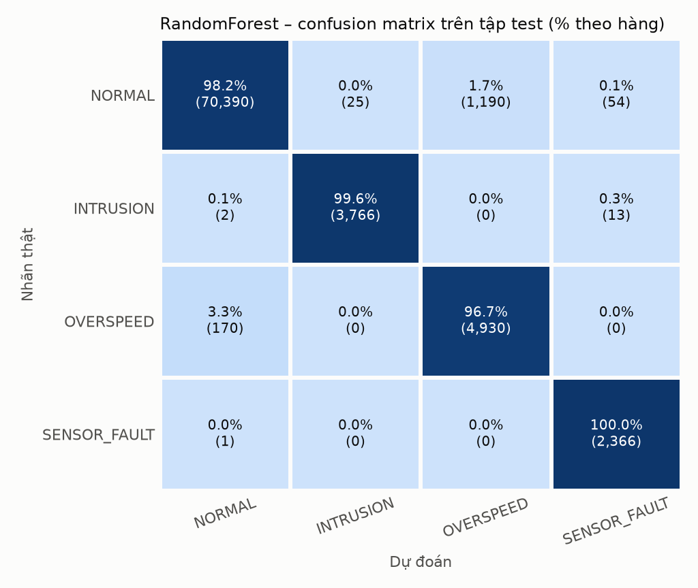
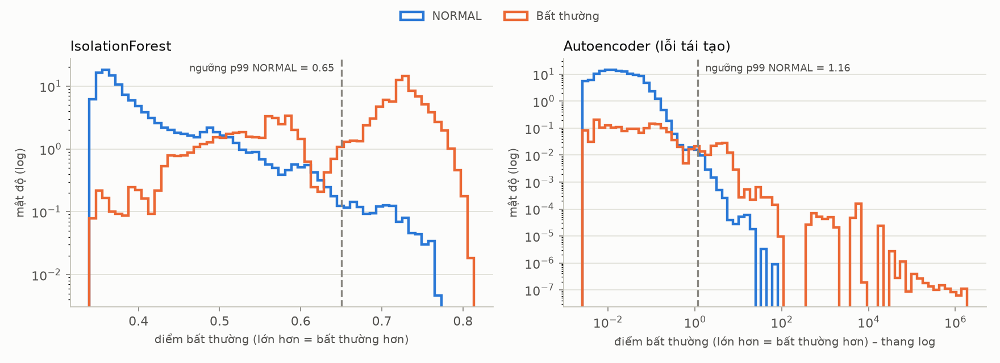

# /ai_model – Phát hiện bất thường và xác nhận DANGER

## Vai trò của AI trong hệ thống

Fast lane trên ESP32 **đã tự dừng robot** khi SSM báo DANGER. AI **không** nằm trong vòng an toàn. Nó chỉ trả lời câu hỏi của trust lane: *"DANGER này có phải người thật không, có đáng ghi sự cố lên blockchain và khóa robot không?"*

| Lớp | Mô hình | Học | Nhiệm vụ |
|---|---|---|---|
| 1 | Luật SSM (ISO/TS 15066) | – | tính zone SAFE / WARNING / DANGER (trên ESP32) |
| 2a | **IsolationForest** | không giám sát, chỉ NORMAL | phát hiện bất thường, kể cả loại **chưa từng thấy** |
| 2a | **Autoencoder** 20→16→8→4→8→16→20 (1.032 tham số) | không giám sát, chỉ NORMAL | như trên; đủ nhỏ để chạy INT8 trên ESP32 (Phase 7) |
| 2b | **RandomForest** (60 cây, sâu 12) | có giám sát, 4 nhãn | phân biệt INTRUSION / OVERSPEED / SENSOR_FAULT → **xác nhận DANGER** |

## Dữ liệu

- **Nguồn:** simulator ([iot_code/simulator](../iot_code/simulator)) chạy **đúng logic firmware**, gồm 5 kịch bản có seed và **nhãn đúng** (ground truth) cho từng mẫu.
- **Chia tập theo seed:**
  - train: 50 lần chạy, 180k bản ghi
  - val: 15 lần chạy, 54k bản ghi
  - test: 25 lần chạy, 90k bản ghi

  Không chia ngẫu nhiên theo dòng, vì các cửa sổ trượt chồng lấn nhau sẽ làm rò rỉ dữ liệu test vào train.
- **Đặc trưng:** 20 đặc trưng trên cửa sổ trượt **2 s (20 bản ghi)**, chỉ nhìn quá khứ nên chạy được thời gian thực ([features.py](hrc_ai/features.py)). Đặc trưng quan trọng nhất là tốc độ thay đổi khoảng cách: người không thể di chuyển 5.000 mm/s, nên giá trị đó chỉ có thể là xung nhiễu.
- **Ngưỡng bất thường:** phân vị 99% điểm của NORMAL trên tập val, tức khoảng 1% báo nhầm theo thiết kế.

## Kết quả trên tập TEST (seed chưa dùng khi huấn luyện)

Chạy lại: `python -m hrc_ai.evaluate`. Số liệu đầy đủ ở [reports/metrics.json](reports/metrics.json).

**1. Xác nhận DANGER, chỉ số quan trọng nhất:**

| Cách | Precision | Recall | F1 | Sự cố giả ghi on-chain |
|---|---:|---:|---:|---:|
| Luật: cứ DANGER là sự cố | 0,840 | 1,000 | 0,913 | **693** |
| **AI: RF xác nhận INTRUSION** | **1,000** | **0,996** | **0,998** | **0** |

AI bỏ sót 13/3.633 cửa sổ có người thật. Robot **vẫn dừng** nhờ fast lane; chỉ thiếu bản ghi sự cố on-chain cho các cửa sổ đó, và log off-chain vẫn còn đầy đủ.

**2. Phân loại 4 nhãn (RandomForest):**

| Nhãn | Precision | Recall | F1 |
|---|---:|---:|---:|
| NORMAL | 0,998 | 0,982 | 0,990 |
| INTRUSION | 0,993 | 0,996 | 0,995 |
| OVERSPEED | 0,806 | 0,967 | 0,879 |
| SENSOR_FAULT (spike, dropout) | 0,973 | 1,000 | 0,986 |
| **Macro** | **0,942** | **0,986** | **0,962** |



**3. Phát hiện bất thường, không giám sát.** Đáp án của bảng này là "2 s gần nhất có bất thường không":

| Mô hình | Precision | Recall | F1 | ROC-AUC | Báo nhầm |
|---|---:|---:|---:|---:|---:|
| IsolationForest | 0,970 | 0,674 | 0,795 | 0,968 | 1,03% |
| Autoencoder | 0,978 | 0,955 | 0,966 | 0,993 | 1,07% |
| IF ∪ AE | 0,969 | 0,963 | 0,966 | 0,992 | 1,52% |



**4. Độ trễ suy luận trên backend:** khoảng 18–35 ms mỗi bản ghi, tùy tải máy, trong chu kỳ telemetry 100 ms. Autoencoder chạy bằng numpy chỉ tốn 0,07 ms. Phần lớn thời gian là của IF và RF (vòng lặp Python qua từng cây).

## Edge AI: autoencoder INT8 trên ESP32 (Phase 7)

**Lượng tử hóa:**
- TFLite converter của TF 2.21, chế độ *full-integer*: đầu vào, đầu ra và trọng số đều int8, bias int32.
- Trọng số lượng tử **theo kênh** (per-channel).
- Dữ liệu đại diện là 500 cửa sổ NORMAL.

Kết quả trên **tập TEST**, cùng giao thức với mục 3 ở trên. Chạy lại: `python -m hrc_ai.evaluate_edge`, số liệu ở [reports/edge_metrics.json](reports/edge_metrics.json).

| Phiên bản | File | Trọng số | Precision | Recall | F1 | ROC-AUC | Báo nhầm |
|---|---:|---:|---:|---:|---:|---:|---:|
| Keras float32 | 53.130 B | 4.128 B | 0,9781 | 0,9546 | 0,9662 | 0,9933 | 1,07% |
| TFLite float32 | 7.560 B | 4.128 B | 0,9781 | 0,9546 | 0,9662 | 0,9933 | 1,07% |
| **TFLite INT8** | **6.952 B** | **1.824 B** | **0,9781** | **0,9544** | **0,9661** | **0,9932** | **1,07%** |

- **Độ chính xác gần như không đổi:** F1 giảm 0,0001. Quyết định bất thường của float và INT8 **trùng nhau ở 99,93%** cửa sổ.
- **Trọng số giảm 2,3 lần.** Riêng ma trận trọng số giảm 4 lần (3.840 B → 960 B); phần còn lại là bias int32 và hệ số lượng tử theo kênh. File .tflite chỉ nhỏ đi chút ít vì phần khung flatbuffer chiếm phần lớn.
- **Mỗi lần suy luận chỉ 960 phép nhân-cộng số nguyên.** Trên firmware, Edge AI chiếm **thêm 5.480 B flash** (kể cả code trích đặc trưng) và 240 B RAM tĩnh.
- **Thời gian suy luận trên ESP32:** firmware tự đo (`EDGESTATS`) và `scripts/measure_latency.py` in ra. Phần này **cần board** mới có số.

**Vì sao firmware dùng runtime INT8 tự viết thay cho thư viện TFLite Micro:**
- esp-tflite-micro chính thức là component của **ESP-IDF**, không có cho PlatformIO/Arduino.
- Bản đóng gói cho Arduino (`TensorFlowLite_ESP32` 1.0.0) có từ năm 2022, cũ hơn converter TF 2.21 và **không kiểm chứng được khi chưa có board**.

Model chỉ gồm 6 lớp `FULLY_CONNECTED`, nên firmware có một runtime khoảng 100 dòng C++ ([hrc_int8_nn.cpp](../iot_code/firmware/src/hrc_int8_nn.cpp)). Runtime này:
- **đọc trọng số và tham số lượng tử từ chính file `.tflite` INT8** (header sinh tự động [hrc_edge_model.h](../iot_code/firmware/include/hrc_edge_model.h));
- cài theo **đúng đặc tả TFLite**: `QuantizeMultiplier`, `MultiplyByQuantizedMultiplier`, `FullyConnectedPerChannel`;
- được kiểm chứng theo chuỗi sau:

```
TFLite interpreter (kernel THAM CHIẾU – loại kernel TFLite Micro dùng)
   == runtime numpy (hrc_ai/edge.py)        TRÙNG TỪNG BIT trên toàn bộ 81.045 cửa sổ test
   == runtime C++ của firmware (g++)        TRÙNG TỪNG BIT (tests/test_edge_ai.py)
features.py ≈ hrc_features.cpp              quyết định bất thường trùng 100% trên mọi kịch bản
```

Phép so sánh còn tự phát hiện TF 2.21 được build với **`TFLITE_SINGLE_ROUNDING`** (làm tròn đơn), khác với mặc định trong tài liệu. Nếu đoán theo tài liệu thì runtime đã lệch bit.

Firmware chạy Edge AI ở **task mạng (core 0)**, mỗi 100 ms, và vẫn chạy khi mất mạng. Kết quả chỉ dùng để **cảnh báo sớm** qua Serial; Edge AI **không** tham gia quyết định ngắt relay. Lúc khởi động, firmware tự kiểm tra bằng 4 vector mẫu; nếu sai thì chỉ tắt Edge AI, không dừng robot.

## Hạn chế (trình bày trung thực trong báo cáo)

1. **Drift chậm không phát hiện được** (recall khoảng 5%). Cảm biến lệch dần 100–250 mm trong 8 s trông **y hệt** người đi chậm, vì chỉ có **một** cảm biến ToF. Đây là giới hạn vật lý, không phải lỗi model.
   - Lần huấn luyện đầu có dạy RF nhãn drift, kết quả là RF báo nhầm **23% dữ liệu NORMAL**.
   - Vì vậy drift **bị loại khỏi tập huấn luyện của RF** và được báo cáo riêng.
   - Giải pháp thật: **cảm biến dư** (kênh kép, ISO 13849 cat. 3), hoặc đối chiếu với vị trí servo.
2. **IsolationForest bỏ sót vượt tốc (0%), Autoencoder bắt 96,7%.** Chẩn đoán: `v_max` của cửa sổ vượt tốc lệch tới **127σ**, nhưng IF chỉ đo "có dễ tách ra không". Một điểm vượt khoảng dữ liệu ở **một** chiều, trong khi 19 chiều còn lại bình thường, chỉ nhận điểm trung bình. Lỗi tái tạo của AE thì **tăng theo độ lớn** độ lệch. Vì vậy quyết định cuối dùng **IF ∪ AE**.
3. **OVERSPEED precision 0,81.** Sau khi đợt vượt tốc kết thúc, cửa sổ 2 s vẫn còn vết vượt tốc trong khi nhãn của bản ghi cuối đã là NORMAL. Đây là độ trễ nhãn vốn có của cửa sổ trượt.
4. **`tf.lite.Interpreter` đã bị đánh dấu *deprecated*** (Google chuyển sang gói LiteRT `ai-edge-litert`). TF 2.21 vẫn chạy được, nhưng khi nâng cấp TF cần chuyển phần đánh giá sang LiteRT. Firmware không bị ảnh hưởng.
5. **Dữ liệu là mô phỏng.** Phase 5 sẽ ghi dữ liệu thật từ ESP32 bằng `hrc-sim --labels-out` (cùng định dạng) để kiểm tra lại, và đo lại các tham số giả định.

## Lệnh

```powershell
pip install -e ".[dev,ai]"          # lần đầu (TensorFlow ~300 MB)
python -m hrc_ai.dataset            # sinh dataset (~15 s) -> ai_model/data/ (không commit, sinh lại được từ seed)
python -m hrc_ai.train              # huấn luyện (~45 s) -> ai_model/models/
python -m hrc_ai.evaluate           # metric + biểu đồ -> ai_model/reports/
hrc-ai-selftest                     # backend nạp model + chạy thử (không cần TensorFlow)
python -m hrc_ai.edge               # lượng tử INT8 -> .tflite + header firmware (kiểm chứng trùng bit)
python -m hrc_ai.evaluate_edge      # so float vs INT8: kích thước, thời gian, độ chính xác
```

## File model (có commit)

| File | Dùng ở đâu |
|---|---|
| `models/hrc_models.joblib` (~1,3 MB) | scaler + IsolationForest + RandomForest. Backend dùng. **Cần scikit-learn đúng 1.9.1** |
| `models/autoencoder.npz` (7 KB) | trọng số AE cho numpy. Backend dùng, không cần TensorFlow |
| `models/autoencoder.keras` (52 KB) | mô hình gốc. Phase 7 lượng tử hóa INT8 lên ESP32 |
| `models/model_meta.json` | ngưỡng, tên đặc trưng, phiên bản thư viện, `feature_fingerprint` (backend cảnh báo nếu lệch) |
| `models/autoencoder_f32.tflite`, `models/autoencoder_int8.tflite` | TFLite float32 / INT8 (Phase 7) |
| `models/edge_int8.npz`, `models/edge_meta.json` | tham số INT8 đã trích + ngưỡng INT8. Dùng cho runtime numpy và các test |
