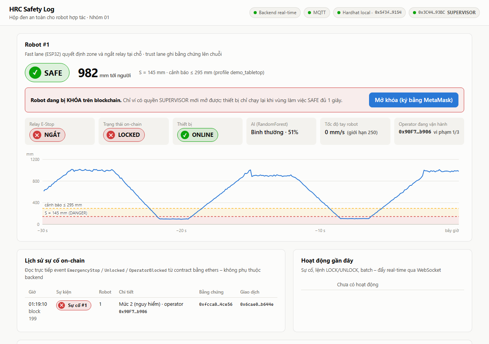

# /dashboard – Giao diện Web3 real-time

Vite 8 + React 19 + TypeScript 5.9 + **ethers 6.17** + MetaMask.



## Tính năng

| Phần | Nguồn dữ liệu |
|---|---|
| Zone SAFE / WARNING / DANGER, khoảng cách, relay, AI, operator: **real-time** | WebSocket `/ws` của backend (10 Hz) |
| Biểu đồ khoảng cách 30 s, kèm ngưỡng S và S+margin (tính theo tốc độ robot hiện tại) | WebSocket |
| **Trạng thái ACTIVE/LOCKED, lịch sử sự cố, mở khóa, khóa operator** | **Đọc THẲNG từ chuỗi** bằng ethers (`getRobot`, event `EmergencyStop` / `Unlocked` / `OperatorBlocked`), không tin backend |
| Nút **Mở khóa**: SUPERVISOR ký `unlock()` bằng **MetaMask** | ethers `BrowserProvider`. Code mô phỏng giao dịch trước (`staticCall`) để báo lỗi rõ ràng |
| Link **Etherscan** cho tx, địa chỉ contract, operator, supervisor | tự bật khi chain = Sepolia; local chỉ hiện mã hash |
| Bảng batch Merkle và nút **Đối soát** (tính lại root từ log off-chain rồi so với root on-chain) | `POST /api/verify/{robot}/{batch}` |
| Nhật ký hoạt động (sự cố, lệnh LOCK/UNLOCK, batch) | WebSocket |

Sau khi SUPERVISOR mở khóa, backend **nghe event `Unlocked`** rồi mới gửi lệnh UNLOCK (có ký HMAC) xuống thiết bị. Dashboard không gọi API riêng nào để mở khóa, và **không có đường nào mở khóa mà không để lại dấu vết trên chuỗi**.

## Chạy

```powershell
cd dashboard
npm install          # lần đầu
npm run dev          # http://localhost:5173 (hot reload)
# hoặc bản build:
npm run build; npm run preview   # http://localhost:4173
```

Cần `hrc-backend` đang chạy ở cổng 8000. Dashboard gọi `/api` và `/ws` qua proxy của Vite. Nếu backend chạy ở địa chỉ khác, đặt biến môi trường `HRC_API`.

## Cài MetaMask cho Hardhat local (1 lần)

1. Cài extension MetaMask, tạo ví mới. Chỉ dùng cho demo.
2. **Nhập tài khoản SUPERVISOR:** MetaMask → *Add account* → *Import account* → dán private key của **Hardhat account #2**. Đây là khóa *công khai*, `npx hardhat node` in ra khi khởi động, và cũng là giá trị `SUPERVISOR_PRIVATE_KEY` trong `.env`. Địa chỉ tương ứng: `0x3C44…93BC`.
3. Mở dashboard → **Kết nối MetaMask**. Nếu MetaMask chưa có mạng Hardhat local (chainId 31337, RPC `http://127.0.0.1:8545`), dashboard sẽ đề nghị thêm mạng.
4. Góc trên phải phải hiện huy hiệu **SUPERVISOR**. Khi robot bị LOCKED, bấm **Mở khóa (ký bằng MetaMask)** → MetaMask hiện giao dịch `unlock` → **Xác nhận**.

**Lỗi thường gặp**

| Hiện tượng | Nguyên nhân / cách xử lý |
|---|---|
| MetaMask báo `nonce too high` sau khi khởi động lại `hardhat node` | Chuỗi local đã về block 0 nhưng MetaMask còn nhớ nonce cũ. Vào MetaMask → *Settings → Advanced → Clear activity tab data* |
| Nút mở khóa bị mờ, ghi "không có quyền SUPERVISOR" | Đang kết nối nhầm tài khoản. Chuyển sang account #2 trong MetaMask; dashboard tự ngắt kết nối, bấm kết nối lại |
| "Robot không ở trạng thái LOCKED (RobotNotLocked)" | Robot đã được mở khóa từ trước (contract từ chối, không tốn gas vì dashboard mô phỏng trước) |
| Mở khóa xong robot lại bị khóa ngay | Người vẫn còn trong vùng nguy hiểm, AI xác nhận lại và ghi sự cố mới. Đúng thiết kế: chỉ mở khóa khi vùng làm việc SAFE |
| Giờ của event on-chain lệch vài chục giây so với giờ máy (local) | Hardhat tăng timestamp mỗi block khi đào nhiều block liên tiếp. Sepolia không có hiện tượng này |
| Không đọc được chuỗi | Hardhat node chưa chạy, hoặc chưa deploy lại sau khi khởi động node (`ignition deploy ... --reset`) |

## Kiểm thử

```powershell
npm run build                                   # tsc strict + build production
python -m pytest -m ui                          # (ở gốc repo) test giao diện bằng Playwright
```

`tests/test_dashboard_e2e.py` tự dựng môi trường riêng và chạy các bước:
1. Deploy contract mới.
2. Chạy backend và dashboard bản build.
3. Cho simulator tạo **sự cố thật** (AI xác nhận, robot LOCKED).
4. Trình duyệt kết nối ví SUPERVISOR và **bấm Mở khóa**.
5. Kiểm trạng thái on-chain chuyển thành ACTIVE, có event `Unlocked` do đúng supervisor ký, backend gửi UNLOCK.
6. Đối soát batch từ UI.

Test thứ 2 kiểm ví **không có quyền** thì nút bị vô hiệu.

Ví trong test là `tests/wallet_shim.js`, theo **chuẩn EIP-1193** (chuẩn mà MetaMask cũng dùng), nên dashboard chạy đúng đường code như khi có MetaMask thật. Nhóm vẫn nên thử một lần bằng MetaMask thật theo hướng dẫn ở trên trước buổi demo.

## Giới hạn (nêu trong báo cáo)

- API backend **không có xác thực**, chỉ nghe `127.0.0.1` cho demo local. Triển khai thật cần xác thực (ví dụ đăng nhập bằng chữ ký ví, SIWE) và HTTPS.
- Quyền mở khóa do **contract** kiểm soát (`onlyRole(SUPERVISOR_ROLE)`). Việc ẩn nút trên giao diện chỉ để tiện dùng, không phải cơ chế bảo mật.
